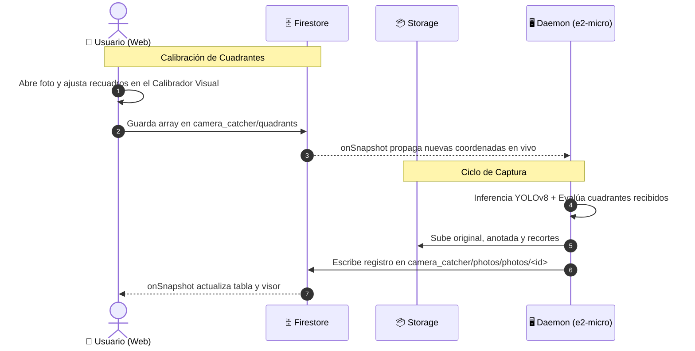

# Referencia Completa del Esquema de Firebase - IOT Camera Catcher

Este documento contiene el inventario exhaustivo de todas las colecciones, documentos, subcolecciones, campos, tipos de datos, rutas de Cloud Storage y servicios de Firebase utilizados en el sistema **IOT Camera Catcher** (Proyecto: `skip-bigotes`).

---

## 1. Cloud Firestore (Base de Datos NoSQL)

Toda la estructura del proyecto está organizada bajo el prefijo raíz `camera_catcher/` para aislar las operaciones de cualquier otro servicio en la base de datos.

### A) `camera_catcher/prompt`
* **Tipo:** Documento individual
* **Rol:** Configuración dinámica del capturador, prompt del LLM e intervalo de ejecución.
* **Leído por:** Backend Daemon (`src/index.js`) vía `onSnapshot` en tiempo real y Frontend Web (`web/app.js`).
* **Escrito por:** Frontend Web (`web/app.js`) y Daemon (para autoinicializar defaults si no existe).

| Campo | Tipo | Ejemplo / Default | Descripción |
| :--- | :--- | :--- | :--- |
| `default` | `string` | `"Describe what do you see in the image"` | Prompt enviado a Gemini Vision API en cada captura periódica. |
| `intervalMinutes` | `number` | `15` | Intervalo en minutos entre cada captura automática (ej. `15`, `1`, `0.5`). |
| `workStartTime` | `string` | `"11:00"` | Hora de inicio de jornada laboral de la barbería (formato 24h `HH:mm` o `11am`). |
| `workEndTime` | `string` | `"23:00"` | Hora de fin de jornada laboral de la barbería (formato 24h `HH:mm` o `11pm`). |
| `configuredTimeZone` | `string` | `"America/Lima"` | Zona horaria para evaluar el horario de operación (`Intl.DateTimeFormat`). |
| `updatedAt` | `string` | `"2026-10-03T14:30:00.000Z"` | Marca de tiempo ISO de la última modificación. |

---

### B) `camera_catcher/commands`
* **Tipo:** Documento individual
* **Rol:** Bus de mensajería asíncrono para disparar acciones manuales inmediatas desde la web hacia el servidor sin necesidad de exponer puertos o endpoints HTTP públicos en la VM.
* **Leído por:** Backend Daemon (`src/index.js`) vía `onSnapshot`.
* **Escrito por:** Frontend Web (`web/app.js`) al hacer clic en *"Capturar Ahora"*.

| Campo | Tipo | Ejemplo | Descripción |
| :--- | :--- | :--- | :--- |
| `action` | `string` | `"capture"` | Acción solicitada al daemon (`"capture"`). |
| `source` | `string` | `"web-dashboard"` | Origen del comando. |
| `requestedAt` | `string` | `"2026-10-03T15:20:00.000Z"` | Marca temporal para evitar procesar eventos viejos o duplicados. |

---

### C) `camera_catcher/status`
* **Tipo:** Documento individual
* **Rol:** Telemetría en vivo del servicio en segundo plano (daemon) en la VM de Google Cloud.
* **Leído por:** Frontend Web (`web/app.js`) para indicadores de salud del sistema.
* **Escrito por:** Backend Daemon (`src/index.js`) al iniciar, al cambiar de estado y tras cada captura.

| Campo | Tipo | Ejemplo | Descripción |
| :--- | :--- | :--- | :--- |
| `isRunning` | `boolean` | `true` | Indica si el daemon de Node.js está activo en la VM. |
| `isCapturing` | `boolean` | `false` | Indica si actualmente se está extrayendo un fotograma por P2P. |
| `lastCaptureAt` | `string` | `"2026-10-03T15:00:00.000Z"` | Fecha/hora ISO de la última captura realizada. |
| `lastCaptureStatus` | `string` | `"success"` / `"error"` | Resultado de la última ejecución. |
| `lastCaptureError` | `string` \| `null` | `null` | Mensaje de error si la última captura falló. |
| `lastCaptureDocId` | `string` | `"photo_1772635959958"` | ID del documento generado en Firestore. |
| `lastInferenceMs` | `number` | `104` | Tiempo en milisegundos que tomó la inferencia con YOLOv8. |
| `activeIntervalMinutes` | `number` | `15` | Intervalo activo actualmente aplicado en el scheduler. |
| `activeWorkHours` | `string` | `"11:00 - 23:00 (America/Lima)"` | Horario de atención vigente. |
| `serverUptimeSeconds` | `number` | `86400` | Segundos transcurridos desde que inició el proceso en la VM. |
| `memoryRssMb` | `number` | `185` | Consumo real de memoria RAM (RSS) del proceso Node.js. |
| `updatedAt` | `string` | `"2026-10-03T15:00:05.000Z"` | Timestamp de actualización de telemetría. |

---

### D) `camera_catcher/quadrants`
* **Tipo:** Documento individual
* **Rol:** Configuración física de las Regiones de Interés (ROI) de la barbería para el clasificador geométrico de Machine Learning.
* **Leído por:** Backend Daemon (`src/detector.js` / `src/index.js`) y Frontend Web (`web/app.js`).
* **Escrito por:** Frontend Web desde el **Calibrador Visual de Cuadrantes** y autoinicializado con defaults por el backend.

| Campo | Tipo | Ejemplo | Descripción |
| :--- | :--- | :--- | :--- |
| `updatedAt` | `string` | `"2026-10-03T16:00:00.000Z"` | Timestamp de la última calibración. |
| `updatedBy` | `string` | `"web-calibrator"` | Origen del ajuste. |
| `quadrants` | `array<object>` | Ver detalle abajo | Lista de zonas de interés normalizadas $[0.0, 1.0]$. |

#### Estructura de cada elemento en `quadrants`:
```json
{
  "id": "silla_barbero_puesto1",
  "name": "Silla de barbero (Puesto 1)",
  "type": "barber_chair",
  "color": "#FFD700",
  "boxNorm": [0.65, 0.80, 1.00, 1.00] 
}
```
* **`boxNorm`**: Formato estándar normalizado `[ymin, xmin, ymax, xmax]` donde cada valor está entre `0.0` y `1.0`. Multiplicado por el ancho y alto de la cámara, determina los píxeles exactos en cualquier resolución.

---

### E) `camera_catcher/photos/photos/<docId>`
* **Tipo:** Subcolección (`collection("camera_catcher", "photos", "photos")`)
* **Nombre de documentos (`docId`):** `photo_<timestamp_epoch_ms>` (ejemplo: `photo_1772635959958`)
* **Rol:** Registro histórico de cada captura realizada, análisis visual y objetos detectados.
* **Leído por:** Frontend Web (`web/app.js`) para renderizar la tabla reactiva con paginación y el visor modal de doble foto.
* **Escrito por:** Backend Daemon (`src/index.js`) tras completar el procesamiento de cada fotograma.

| Campo | Tipo | Ejemplo | Descripción |
| :--- | :--- | :--- | :--- |
| `id` | `string` | `"photo_1772635959958"` | Identificador único del fotograma. |
| `epoch` | `number` | `1772635959958` | Marca de tiempo en milisegundos para ordenamiento eficiente. |
| `timestamp` | `Timestamp` | `ServerTimestamp()` | Timestamp nativo de Firestore. |
| `capturedAt` | `string` | `"2026-10-03T15:00:00.000Z"` | Fecha/hora ISO legible. |
| `camera` | `string` | `"barberia"` | Identificador de la cámara origen. |
| `source` | `string` | `"gcp-e2-micro"` | Nodo de procesamiento que ejecutó la captura. |
| `imageStoragePath` | `string` | `"camera_catcher/photos/photo_...jpg"` | Ruta al archivo JPEG original en Firebase Storage. |
| `annotatedStoragePath`| `string` | `"camera_catcher/photos/photo_..._annotated.jpg"` | Ruta a la foto con los cuadrantes y etiquetas dibujadas en Storage. |
| `quadrants` | `array<object>` | `[{ id, label, category, color, box, status }]` | Cuadrantes semánticos evaluados en este fotograma. |
| `clientCrops` | `array<object>` | `[{ id, label, storagePath, confidence, box }]` | Lista de imágenes recortadas individualmente de los clientes sentados. |
| `inferenceMs` | `number` | `102` | Duración del procesamiento de ML local con YOLOv8. |
| `skippedDueToNoChange`| `boolean` | `false` | Indica si se omitió la inferencia completa por frame differencing (< 2.5% cambio). |
| `diffPercent` | `number` | `8.45` | Porcentaje de variación física de la escena frente al fotograma anterior. |
| `geminiAnalysis` | `string` | `"Se observa un cliente sentado..."` | Descripción textual si Gemini Vision estuvo activo. |
| `promptUsed` | `string` | `"Describe what do you see in the image"` | Prompt que se utilizó en la captura. |

---

## 2. Firebase Cloud Storage (Almacenamiento de Archivos)

* **Bucket:** `skip-bigotes.firebasestorage.app`
* **Ubicación:** `us-central1` (Google Cloud Storage)
* **Estructura de Carpetas:**

```
camera_catcher/
└── photos/
    ├── photo_1772635959958.jpg            # Fotograma original sin modificaciones
    ├── photo_1772635959958_annotated.jpg  # Fotograma con recuadros de cuadrantes y badges SVG
    ├── photo_1772635959958_client_1.jpg   # Recorte de alta resolución del cliente sentado 1
    └── ...
```

### Reglas de Seguridad (`storage.rules`)
```javascript
rules_version = '2';
service firebase.storage {
  match /b/{bucket}/o {
    match /camera_catcher/photos/{allPaths=**} {
      allow read: if true;                     // Lectura pública para el dashboard web CDN
      allow write: if request.auth != null;    // Escritura restringida al backend con service account
    }
  }
}
```

---

## 3. Firebase Hosting

* **Sitio:** `skip-bigotes` (`camera-catcher-bigotes.web.app`)
* **Archivos desplegados (`web/`):**
  - `index.html`: Estructura del panel, visor modal dual, monitor de costos y calibrador de cuadrantes.
  - `app.js`: Lógica cliente en JavaScript Vanilla con Firebase SDK v10 (Firestore y Storage).
  - `style.css`: Sistema de diseño moderno en tema oscuro con variables CSS, animaciones y diseño responsivo.

---

## 4. Resumen de Flujo de Datos Cruzado


