# Guía Técnica del Pipeline Funcional: `processes.js` y `src/services/pipeline/`

Este documento constituye la especificación canónica y el manual técnico de operación para [`src/services/processes.js`](file:///Users/javierli/Documents/elmuki/IOTCameraCatcher/src/services/processes.js) y su paquete de etapas desacopladas en [`src/services/pipeline/`](file:///Users/javierli/Documents/elmuki/IOTCameraCatcher/src/services/pipeline), el **Pipeline Core de Percepción, Seguimiento y Biometría** de **IOT Camera Catcher**.

Cualquier agente de IA o desarrollador que necesite auditar, modificar, extender o depurar el flujo de visión y biometría debe estudiar y respetar los principios arquitectónicos descritos aquí.

---

## 🏛️ Filosofía Arquitectónica del Pipeline

El Pipeline Core está estructurado bajo el principio de **separación estricta de responsabilidades y orquestación declarativa**:

1. **Orquestador Declarativo (`processes.js`)**:
   - Actúa exclusivamente como el director de orquesta de alto nivel (< 110 líneas en total).
   - La función maestra `runProcessCycle(context, options)` (< 70 líneas) encadena las etapas de manera puramente lineal y legible, libre de lógica procedural de bajo nivel.
   - Re-exporta como fachada pública las funciones de cada step para mantener 100% de compatibilidad hacia atrás con el resto del sistema y las suites de prueba.
2. **Módulos de Pasos Independientes (`src/services/pipeline/*.js`)**:
   - Toda la lógica procedural pesada (manipulación de buffers con Sharp, transformaciones de coordenadas, llamadas ONNX, sincronizaciones locales SQLite/WAL y sockets) vive confinada en módulos específicos.
   - Cada step expone funciones puras, desacopladas y aisladamente testeables.
3. **Eficiencia de recursos ($0 Cloud / 1 GB RAM)**:
   - Diseñado para operar 24/7 sobre una máquina virtual GCP `e2-micro` sin saturar CPU ni memoria.

---

## 📁 Estructura Modular de Archivos

```
src/services/
├── processes.js                         # Orquestador declarativo principal (< 110 líneas)
└── pipeline/
    ├── acquisition_step.js              # acquireFrame, uploadDiagnosticSnapshot
    ├── clear_stream_step.js             # acquireClearFrame, enrichCropsWithClearStream
    ├── detection_step.js                # detectScene
    ├── tracking_step.js                 # trackEntities, matchIdentitiesToTracks
    ├── biometrics_step.js               # extractClientCrops, reidentifyPeople
    ├── visits_step.js                   # updateVisits
    ├── occupancy_step.js                # computeOccupancy
    ├── telemetry_step.js                # broadcastTelemetry
    └── persistence_step.js              # persistCycleData
```

---

## 🔄 Diagrama de Flujo del Pipeline (Ciclo de Ejecución)

```mermaid
flowchart TD
    START(["Inicio del Ciclo (runProcessCycle)"]) --> S1["1. acquireFrame<br/>(acquisition_step.js: RAM 0ms en realtime / P2P Neolink en manual)"]
    S1 --> S2["2. uploadDiagnosticSnapshot<br/>(acquisition_step.js: Solo si es manual / arranque)"]
    S2 --> S3["3. detectScene<br/>(detection_step.js: ONNX Runtime + YOLOv8 + Cuadrantes)"]
    S3 --> S4["4. trackEntities<br/>(tracking_step.js: PersonTracker espacial trackId)"]
    S4 --> TEL_EARLY["⚡ broadcastTelemetry Inmediato<br/>(telemetry_step.js: SSE <50ms Cajas y Tracks)"]
    TEL_EARLY --> CLEAR["4b. enrichCropsWithClearStream<br/>(clear_stream_step.js: Snapshot RTSP 2560x1440, reescalado y recortes Sharp)"]
    CLEAR --> S5A["5a. extractClientCrops<br/>(biometrics_step.js: Recortes y storage manual)"]
    S5A --> S5B["5b. reidentifyPeople<br/>(biometrics_step.js: ArcFace + CustomerService SQLite WAL)"]
    S5B --> S6["6. matchIdentitiesToTracks<br/>(tracking_step.js: Asociación Espacial IoU Box-to-Track)"]
    S6 --> S7["7. updateVisits<br/>(visits_step.js: VisitSessionService Check-in / Check-out)"]
    S7 --> S8["8. computeOccupancy<br/>(occupancy_step.js: Cálculo Funcional Puro de Ocupación)"]
    S8 --> TEL_FINAL["9. broadcastTelemetry Enriquecido<br/>(telemetry_step.js: SSE con Identidades y Ocupación)"]
    TEL_FINAL --> S10["10. persistCycleData<br/>(persistence_step.js: SQLite Local + Tick Atómico / Firestore Manual)"]
    S10 --> END(["Fin del Ciclo"])
```



---

## 🧩 Desglose Técnico de los Módulos de Pipeline

### 1. `acquisition_step.js`
* **`acquireFrame({ streamServer, tomlPath, docId, isRealtime, triggerSource, localOutputPath })`**:
  * En modo `realtime`: Recupera en **0 ms** el buffer JPEG más reciente almacenado en memoria RAM por el stream RTSP continuo (`streamServer.getLatestFrame()`). Si el stream aún no ha decodificado el primer fotograma, retorna `null` y el ciclo suspende gracefully (`waiting_for_frame`).
  * En modo `manual`: Realiza la invocación P2P UDP directa mediante el binario Neolink (`captureSnapshotAdaptive`).
  * **Resiliencia & Auto-recuperación**: El servidor de streaming (`StreamServer`) incorpora el hook `onEnsureRtspSource` para levantar automáticamente el contenedor `neolink-daemon` en el puerto 8554 si se apaga, y retiene `latestFrameBuffer` para evitar errores 503 en `/api/snapshot`.
* **`uploadDiagnosticSnapshot({ bucket, docId, buffer, isManual })`**:
  * Registra el fotograma completo en Firebase Storage únicamente si `isManual === true` (disparos manuales o arranque). En modo tiempo real 24/7 no se sube la foto completa para prevenir costos y saturación de cuota.

### 2. `clear_stream_step.js`
* **Gestión de Cooldown Global**:
  * Variable de módulo `clearStreamDisabledUntil` que aplica 60 segundos de enfriamiento ante desconexiones o fallos del RTSP Clear.
* **`acquireClearFrame({ localOutputPath, rtspUrl, timeoutMs })`**:
  * Adquisición bajo demanda del fotograma en ultra alta resolución (2560x1440) vía `captureSnapshotFromRtsp`.
  * **Timeout optimizado a 1500 ms**: Degrada de manera segura retornando `null` si la cámara no responde en tiempo límite, evitando bloqueos del Event Loop.
* **`enrichCropsWithClearStream({ activeTracks, mlResult, options, context, docId, localOutputPath })`**:
  * **Función Extraída Central**: Encapsula las 130 líneas de evaluación de necesidad de nitidez, reescalado geométrico y procesamiento de imágenes con Sharp.
  * **Filtro de Detección**: Evalúa personas en sillas de corte o espera con nitidez de rostro `< 60` y fuera de su enfriamiento de 12 segundos (`CLEAR_COOLDOWN_MS = 12000`).
  * **Reescalado de Coordenadas**: Calcula factores de escala (`scaleX = clearW / origW`, `scaleY = clearH / origH`) o proyecta cajas normalizadas `boxNorm` a las dimensiones 2560x1440 del frame Clear.
  * **Recorte de Alta Resolución Sharp**: Realiza la extracción (`sharp.extract()`) a calidad JPEG 95% y actualiza el recorte existente en `mlResult.clientCrops` o genera uno nuevo con `isHighRes: true`.
  * **Ejecución Reactiva Flexible**: Soporta tanto ejecución síncrona/bloqueante como desacoplada en segundo plano si se solicita con `options.asyncClear === true`.

### 3. `detection_step.js`
* **`detectScene(buffer, { isRealtime })`**:
  * **Detección Exclusiva de Personas ($O(1)$)**: YOLOv8n accede directamente a la clase 0 (`person`), eliminando el escaneo de las 79 clases restantes en los 8,400 anchors (ahorro de 660,000 iteraciones por ciclo).
  * **Modo Centinela Dinámico de Saltos Estáticos**:
    * Si la variación respecto al frame anterior es `< 1%` y **no hay personas en la escena**, permite hasta **25 saltos consecutivos (~30s a 0% CPU / 0 ms)**.
    * Si hay personas presentes, limita a 5 saltos para mantener reactividad en el tracking.
  * Mapea detecciones a los polígonos/cuadrantes configurados en Firestore (`camera_catcher/quadrants`).

### 4. `tracking_step.js`
* **`trackEntities(tracker, mlResult)`**:
  * Correlaciona centroides y cajas delimitadoras cuadro a cuadro con `PersonTracker.update`, asignando un `trackId` persistente a cada individuo.
* **`matchIdentitiesToTracks({ tracker, activeTracks, identifiedPeople, iouThreshold })`**:
  * Asocia identidades biométricas al tracker mediante superposición espacial IoU (umbral por defecto `>= 0.20`), evitando cruzar identidades de staff con clientes sentados.

### 5. `biometrics_step.js`
* **`extractClientCrops({ bucket, clientCrops, docId, isManual })`**:
  * Procesa recortes de personas en zonas de atención; si es disparo manual, genera la subida correspondiente a Storage.
* **`reidentifyPeople({ db, clientRecords, clientCrops, activeSessions, isRealtime, backgroundSync })`**:
  * Filtro de calidad facial RFB-320 (frontalidad y nitidez) + ArcFace MobileFaceNet ONNX (embedding 512D en ~15 ms).
  * **Almacenamiento Biométrico Podado en RAM**: `getAllComparisonProfiles()` almacena únicamente embeddings en memoria (0 Base64). `getCustomerData(id)` hidrata la información completa bajo demanda desde SQLite local (`data/barberia.db`) únicamente al consolidar la sesión.
  * Gobernanza por sesión temporal: previene perfiles espurios en sillas activas y fusiona ángulos complementarios en la galería del cliente (hasta 20 fotos/embeddings).

### 6. `visits_step.js`
* **`updateVisits({ visitService, tracker, activeTracks })`**:
  * Control del ciclo de vida de visitas: apertura de sesión al sentarse (`isServiceChair`), seguimiento de mejor foto y cierre de sesión con cálculo de estancia al abandonar la escena.

### 7. `occupancy_step.js`
* **`computeOccupancy({ quadrants, identifiedPeople, rawDetections })`**:
  * Función matemática pura que calcula clientes en corte (`clientsInCut`), en espera (`clientsWaiting`), barberos activos (`activeBarbers`) y total de personas (`totalHumans`).

### 8. `telemetry_step.js`
* **`broadcastTelemetry({ docId, mlResult, activeTracks, identifiedPeople, occupancy })`**:
  * Emisión SSE en tiempo real hacia `/api/yolo/stream` (frontend web).
  * Emisión temprana inmediata (< 50 ms) y emisión final enriquecida con biometría, ocupación y **métricas de memoria RAM del sistema** (`rssMB`, `heapUsedMB`, `heapTotalMB`, `osFreeMB`).

### 9. `persistence_step.js`
* **`persistCycleData({ db, docId, timestamp, storagePath, clientRecords, identifiedPeople, mlResult, visitService, activeTracks, occupancy, isRealtime })`**:
  * Modo tiempo real: Emite tick atómico a través de `daemonReporter` sin generar escrituras ruidosas en Firestore.
  * Modo manual: Persiste el documento histórico completo en `camera_catcher/photos/photos/<docId>` con sanitización estricta.

---

## 🛡️ Guía para Futuros Agentes de IA

Si recibes una tarea que implique modificar o extender el Pipeline Core:

1. **Regla de Oro 8 (Prohibición Estricta de Ensuciar `processes.js`)**:
   - `processes.js` es **únicamente un orquestador declarativo** (< 110 líneas).
   - **NUNCA agregues lógica procedural dentro de `processes.js`**. Si necesitas añadir una nueva característica (ej: nuevo paso de detección, compresión adicional, filtrado de audio, etc.), crea un nuevo archivo en `src/services/pipeline/nuevo_step.js` e invócalo limpiamente en `runProcessCycle`.
2. **Pureza e Interfaces Explícitas**:
   - Las etapas en `src/services/pipeline/` deben recibir sus dependencias explícitamente y retornar valores claros sin mutaciones colaterales imprevistas.
3. **Respetar la Gobernanza Temporal de Sesión**:
   - Nunca modifiques el flujo biométrico para crear clientes instantáneamente en la silla de un cliente ya activo.
4. **Validación Obligatoria de Tests y Frontend**:
   - Ejecuta siempre `npm test` (particularmente `test/test-processes.js`).
   - Ejecuta siempre `npm run build:web` para asegurar cero rupturas en Vite y Vue.
