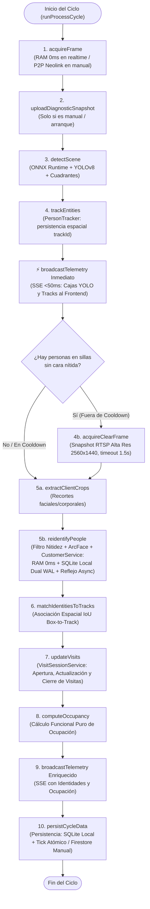

# Guía Técnica del Pipeline Funcional: `processes.js` (Componente Core del Sistema)

Este documento constituye la especificación canónica y el manual técnico de operación para [`src/services/processes.js`](file:///Users/javierli/Documents/elmuki/IOTCameraCatcher/src/services/processes.js), el **Pipeline Core de Percepción, Seguimiento y Biometría** de **IOT Camera Catcher**.

Cualquier agente de IA o desarrollador que necesite auditar, modificar, extender o depurar el flujo de visión y biometría debe estudiar y respetar los principios arquitectónicos descritos aquí.

---

## 🏛️ Filosofía Arquitectónica del Pipeline

El módulo [`src/services/processes.js`](file:///Users/javierli/Documents/elmuki/IOTCameraCatcher/src/services/processes.js) fue diseñado bajo el principio de **descomposición funcional lineal (Pipeline Pattern)**:
- **Funciones puras y desacopladas**: Cada fase del ciclo es una función unitaria testeable, con entradas y salidas explícitas.
- **Orquestación declarativa**: La función maestra `runProcessCycle(context, options)` actúa como el director de orquesta que encadena las etapas de manera legible sin anidamientos excesivos.
- **Eficiencia de recursos ($0 Cloud / 1 GB RAM)**: Diseñado para operar 24/7 sobre una máquina virtual GCP `e2-micro` sin saturar CPU ni memoria.

---

## 🔄 Diagrama de Flujo del Pipeline (Ciclo de Ejecución)

---

## 🧩 Desglose Técnico de las 10 Funciones del Pipeline

### 1. `acquireFrame({ streamServer, tomlPath, docId, isRealtime, triggerSource, localOutputPath })`
* **Propósito**: Obtener el fotograma base de la escena.
* **Comportamiento Reactivo**:
  * En modo `realtime`: Recupera en **0 ms** el buffer JPEG más reciente almacenado en memoria RAM por el stream RTSP continuo (`streamServer.getLatestFrame()`). Si el stream aún no ha decodificado el primer fotograma, retorna `null` y el ciclo suspende gracefully (`waiting_for_frame`).
  * En modo `manual`: Realiza la invocación P2P UDP directa mediante el binario Neolink (`captureSnapshotAdaptive`).

### 2. `uploadDiagnosticSnapshot({ bucket, docId, buffer, isManual })`
* **Propósito**: Registrar el fotograma completo en Firebase Storage.
* **Regla de Oro**: Solo se ejecuta si `isManual === true` (disparos manuales o arranque). En modo tiempo real 24/7, **no se sube la foto completa**, previniendo saturación de cuota y costos en Storage.

### 3. `detectScene(buffer, { isRealtime })`
* **Propósito**: Percepción de objetos mediante red neuronal convolucional local.
* **Mecanismo**:
  1. Verifica cambio visual contra el frame previo (`checkFrameDifference`). Si la variación es inferior al umbral (2.5%), reutiliza el análisis anterior a **0% CPU / 0 ms**.
  2. Ejecuta YOLOv8n (`yolov8n.onnx`) en CPU mono-hilo con ONNX Runtime.
  3. Aplica Non-Maximum Suppression (NMS).
  4. Mapea las cajas detectadas a los polígonos/cuadrantes configurados en Firestore (`camera_catcher/quadrants`).

### 4. `trackEntities(tracker, mlResult)`
* **Propósito**: Seguimiento temporal y espacial continuo de personas.
* **Mecanismo**: `PersonTracker.update` correlaciona centroides y cajas delimitadoras cuadro a cuadro, asignando un `trackId` persistente a cada individuo mientras camina o permanece en la barbería.

### 4b. `acquireClearFrame({ localOutputPath, rtspUrl, timeoutMs })` (Reactivo Bajo Demanda)
* **Propósito**: Adquisición reactiva del stream principal en ultra alta resolución (2560x1440).
* **Mecanismo**:
  * Si una persona sentada en una silla de corte o espera carece de una captura facial nítida (nitidez < 60) y no está en período de enfriamiento (12 segundos), se solicita un fotograma Clear vía RTSP.
  * **Timeout optimizado a 1500 ms**: Reducido de 8000 ms a 1500 ms con degradación elegante al recorte ligero si el RTSP no responde de inmediato, garantizando cero congelamientos del Event Loop de Node.js.

### 5a. `extractClientCrops({ bucket, clientCrops, docId, isManual })`
* **Propósito**: Extrae los recortes de personas sentadas o en zonas de trabajo. Si es manual, genera el registro de almacenamiento asociado.

### 5b. `reidentifyPeople({ db, clientRecords, clientCrops, activeSessions })`
* **Propósito**: Identificación biométrica facial gobernada por sesión, calidad y almacenamiento local dual ultra-rápido.
* **Componentes clave**:
  * **Filtro RFB-320**: Evalúa frontalidad y nitidez descartando nucas, espaldas o desenfoques.
  * **ArcFace MobileFaceNet ONNX**: Extrae el embedding de 512 dimensiones normalizado L2 en ~15 ms.
  * **Almacenamiento Biométrico Dual (`CustomerService` + SQLite WAL)**:
    * **0 ms latencia**: `CustomerService.getComparisonProfiles()` consulta perfiles biométricos en memoria RAM sin llamadas de red a Firestore.
    * **Paridad de Entornos SQLite**: `data/barberia.db` en producción (`(default)`) y `data/barberia_test.db` en desarrollo/simulación (`test`).
    * **Vectores en BLOB**: Embeddings almacenados como buffers binarios compactos de 2048 bytes.
  * **Gobernanza por Sesión Temporal**: Si el rostro detectado ocurre en la silla de una sesión activa que ya tiene cliente asignado:
    * **Cero perfiles nuevos**: No se crean nuevos clientes ni candidatos espurios.
    * **Fusión de Ángulo y Calidad**: Si el nuevo vector aporta un ángulo complementario (similitud 0.50 a 0.88), una pose no representada o mayor nitidez, se anexa a su galería local y se refleja a Firestore (tope ampliado a 20 con diversidad posicional).
  * **Debounce de 3 Ciclos**: Si no hay sesión previa y el cliente es nuevo, debe permanecer 3 ciclos consecutivos antes de registrarse localmente en SQLite y reflejarse asíncronamente en Firestore.

### 6. `matchIdentitiesToTracks({ tracker, activeTracks, identifiedPeople, iouThreshold })`
* **Propósito**: Fusiona la identidad biométrica al objeto rastreado (`track`) mediante superposición espacial IoU (Intersection over Union >= 0.20).

### 7. `updateVisits({ visitService, tracker, activeTracks })`
* **Propósito**: Gestión del ciclo de vida de la visita del cliente en la barbería:
  * **Check-In**: Cuando una persona se sienta en una silla de corte (`isServiceChair`), se abre una sesión con `startedAt`.
  * **Seguimiento**: Actualiza el récord de mejor cara nítida (`bestFaceScore`) y sube la miniatura a Storage (~30 KB).
  * **Check-Out**: Cuando el track abandona la silla o la escena, calcula `durationMinutes` y persiste la visita en `camera_catcher_visits/<visitId>`.

### 8. `computeOccupancy({ quadrants, identifiedPeople, rawDetections })`
* **Propósito**: Función matemática pura que calcula métricas de ocupación en tiempo real:
  * `clientsInCut`: Clientes atendidos en sillas de corte.
  * `clientsWaiting`: Clientes en sillas de espera.
  * `activeBarbers`: Barberos laborando activamente.
  * `totalHumans`: Detecciones globales de clase `person`.

### 9. `broadcastTelemetry({ docId, mlResult, activeTracks, identifiedPeople, occupancy })`
* **Propósito**: Emite la telemetría en tiempo real por Server-Sent Events (SSE) a través de `telemetryStream` (accesible en `/api/yolo/stream` tanto en local como por el túnel seguro `https://stream.perrosuelto.com`):
  * **Emisión Temprana (<50 ms)**: Disparada inmediatamente tras `trackEntities` para alimentar el HUD visual y bounding boxes sin esperar a la inferencia biométrica.
  * **Emisión Enriquecida**: Actualiza al cliente web con identidades asociadas, métricas de ocupación y cuadrantes actualizados.

### 10. `persistCycleData({ db, docId, timestamp, storagePath, clientRecords, identifiedPeople, mlResult, visitService, activeTracks, occupancy, isRealtime })`
* **Propósito**: Persistencia de estado y paridad:
  * En tiempo real: Actualiza visitas locales en SQLite y emite el tick de estado en memoria/SSE sin generar escrituras ruidosas ni duplicar documentos en Firestore.
  * En manual: Persiste el documento histórico completo en `camera_catcher/photos/photos/<docId>`.

---

## 🛡️ Guía para Futuros Agentes de IA

Si recibes una tarea que implique modificar o extender [`src/services/processes.js`](file:///Users/javierli/Documents/elmuki/IOTCameraCatcher/src/services/processes.js):

1. **Mantener la Pureza de Etapas**: No mezcles lógica de almacenamiento dentro de funciones de cálculo espacial, ni añadas dependencias directas entre etapas no contiguas. Todo flujo de datos debe pasar a través de los argumentos de entrada y valores de retorno.
2. **Respetar la Gobernanza Temporal de Sesión**: Nunca modifiques el flujo biométrico para crear clientes instantáneamente en la silla de un cliente ya activo. La sesión temporal es la fuente de verdad que previene la fragmentación de perfiles.
3. **Validación Obligatoria de Tests**: Cada cambio en el pipeline funcional debe acompañarse de su correspondiente aserción en [`test/test-processes.js`](file:///Users/javierli/Documents/elmuki/IOTCameraCatcher/test/test-processes.js). Ejecuta siempre `npm test` antes de considerar completada cualquier tarea.
4. **Verificación de Compilación Frontend**: Si añades o alteras datos emitidos por telemetría hacia el frontend, compila con `npm run build:web` para asegurar cero rupturas en Vite y Vue.
