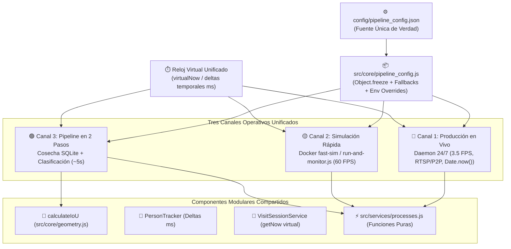

# ADR 21: Configuración Canónica Unificada (pipeline_config.json) y Unificación Determinista de Canales (Vivo, Grabado y Dos Pasos)

* **Estado**: Aceptado / En Producción  
* **Fecha**: Octubre 2026  
* **Responsable**: Antigravity & Javier  
* **Contexto**: Unificación Arquitectónica del Pipeline de Percepción, Biometría y Sesiones

---

## 1. Contexto y Problema

Durante la evolución del sistema de captura e inteligencia biométrica de la barbería, el procesamiento de imágenes y la gestión del ciclo de vida de los clientes llegó a ejecutarse en tres canales operativos distintos:

1. **Canal 1: Producción en Vivo**: Daemon Node.js 24/7 en Compute Engine (`e2-micro`), ingiriendo flujos RTSP/P2P de la cámara a ~3.5 FPS con marcas temporales reales del sistema (`Date.now()`).
2. **Canal 2: Simulación Rápida con Video Grabado**: Contenedor Docker (`fast-sim` o `e2-sim`) y runner unificado ([`scripts/run-and-monitor.js`](file:///Users/javierli/Documents/elmuki/IOTCameraCatcher/scripts/run-and-monitor.js)), reproduciendo archivos de video (ej. 7 o 10 horas) a alta velocidad (hasta 60 FPS) para pruebas de integración de extremo a extremo.
3. **Canal 3: Testing en Dos Pasos (Cosecha + Clasificación)**: Metodología desacoplada donde el Paso 1 extrae y almacena recortes de personas con YOLOv8 en SQLite ([`scripts/step1_harvest_crops.js`](file:///Users/javierli/Documents/elmuki/IOTCameraCatcher/scripts/step1_harvest_crops.js)), y el Paso 2 aplica biometría, filtrado y cierre de citas ([`scripts/step2_classify_sessions.js`](file:///Users/javierli/Documents/elmuki/IOTCameraCatcher/scripts/step2_classify_sessions.js)) en ~5 segundos.

Esta coexistencia histórica generó tres problemas estructurales graves:

### A. Dispersión de Umbrales y Divergencia de Configuración
Las constantes y umbrales biométricos, espaciales y de sesión (confianza de detección facial, nitidez mínima, proporciones de piel, umbral de exclusión de barbero, ventana de gracia de silla vacía, quórum de rotación y consolidación de citas) se encontraban duplicados o hardcodeados en múltiples archivos (`src/detector.js`, `src/services/face_quality_service.js`, `src/core/barbershop_rules.js`, `src/services/visit_session_service.js` y diversos scripts). Modificar un parámetro en un script de prueba no impactaba en producción, generando diagnósticos artificiales y falsos positivos no reproducibles.

### B. No Determinismo por Conteo Ciego de Cuadros (Frame Counting)
Tanto [`PersonTracker`](file:///Users/javierli/Documents/elmuki/IOTCameraCatcher/src/core/person_tracker.js) como las máquinas de estado dependían de contadores ciegos de fotogramas (ej. `consecutiveChairFrames >= 6` o `leaveDebounceFrames >= 6`). Esta métrica provocaba una divergencia catastrófica entre canales:
- A **3.5 FPS** en vivo, 6 frames equivalían a **~1.71 segundos** de estabilidad antes de confirmar a una persona sentada.
- A **60 FPS** en simulación acelerada, 6 frames equivalían a escasos **100 milisegundos**, provocando que transeúntes fugaces o fluctuaciones de detección dispararan sesiones falsas.
- Ante caídas momentáneas de frames o variaciones de carga en la CPU de la VM, los tiempos físicos reales de las atenciones se distorsionaban.

### C. Desalineación Espacial en Pruebas Offline
En la primera generación de pruebas en dos pasos, la extracción y asignación de recortes a sillas utilizaba heurísticas simplificadas que no calculaban el IoU (Intersection over Union) exacto frente a los tracks delimitados por YOLOv8, perdiendo la trazabilidad espacial del `trackId` y alterando la correlación biométrica respecto al comportamiento real del daemon en vivo.

---

## 2. Decisión Arquitectónica

Se aprueba y establece la unificación determinista y canónica del pipeline a través de cuatro pilares:

### 1. Centralización en `pipeline_config.json` y `pipeline_config.js`
Se establece [`config/pipeline_config.json`](file:///Users/javierli/Documents/elmuki/IOTCameraCatcher/config/pipeline_config.json) como la **única fuente de verdad** para todos los parámetros del sistema, consumida a través de [`src/core/pipeline_config.js`](file:///Users/javierli/Documents/elmuki/IOTCameraCatcher/src/core/pipeline_config.js).

El módulo expone configuraciones congeladas (`Object.freeze`), previene mutaciones en tiempo de ejecución, cuenta con valores por defecto resilientes y permite sobrescritura granular mediante variables de entorno en testing de integración:

* **`faceDetection`**:
  * `minConfidence: 0.70` (umbral mínimo para detección RFB-320).
  * `minSharpness: 20.0` (filtro Laplaciano contra fotos borrosas).
  * `skinRatioMin: 0.18` y `warmRatioMin: 0.22` (validación de piel humana YCbCr y calidez).
  * `validFacePoses: ["frontal", "tilted_up", "tilted_down", "semi_profile_left", "semi_profile_right", "tilted_up_left", "tilted_up_right"]` (rechazo anatómico de nucas, espaldas y orejas).
* **`staffFilter`**:
  * `staffExclusionThreshold: 0.46` (similitud coseno contra galería de staff/barbero).
  * `staffMaxBarberRatio: 0.50` (proporción máxima tolerada antes de descartar sesión entera).
* **`tracking`**:
  * `iouThreshold: 0.30` (asociación espacial caja-a-track y recorte-a-caja).
  * `minChairFrames: 6` y `minChairDurationMs: 2000` (tiempo mínimo para confirmar sentado formal).
  * `leaveDebounceFrames: 6` y `leaveDebounceDurationMs: 2000` (persistencia antes de declarar salida).
* **`sessions`**:
  * `emptyChairTimeoutMs: 45000` (ventana de gracia de 45 segundos para pausas breves del barbero).
  * `minAppointmentMinutes: 8` y `minAppointmentPhotos: 3` (umbral de evidencia para formalizar cita legítima).
  * `maxGalleryPhotos: 20` (tope de galería multi-ángulo por cliente).
  * `rotationQuorumPhotos: 8`, `rotationQuorumSpanMs: 60000`, `rotationDisjunctionSim: 0.44` (quórum temporal y biométrico para rotación rápida sin silla vacía).
* **`consolidation`**:
  * `maxMergeGapMs: 2700000` (45 min), `minMergeGapMs: -300000` (-5 min), `minSimilarity: 0.42` (fusión cronológica Set-to-Set entre segmentos del mismo cliente).

### 2. Determinismo Temporal Mediante Reloj Virtual Unificado
Se erradican las decisiones basadas exclusivamente en conteo ciego de cuadros en [`PersonTracker`](file:///Users/javierli/Documents/elmuki/IOTCameraCatcher/src/core/person_tracker.js) y [`VisitSessionService`](file:///Users/javierli/Documents/elmuki/IOTCameraCatcher/src/services/visit_session_service.js):
- **Sustitución por deltas de tiempo**: La confirmación de sentado y el desenganche se evalúan comparando `(now - track.chairEnteredAt) >= minChairDurationMs` y `(now - track.chairLeftAt) >= leaveDebounceDurationMs`.
- **Reloj Virtual Centralizado**: En [`src/services/processes.js`](file:///Users/javierli/Documents/elmuki/IOTCameraCatcher/src/services/processes.js), cada ciclo calcula `virtualNow` consultando `visitService.getNow()` (el cual sincroniza con el reloj del video en simulaciones) o `streamServer.getVirtualNow()`, recurriendo a `Date.now()` únicamente en producción en vivo.
- **Propagación Uniforme**: `virtualNow` se pasa como parámetro inmutable a `trackEntities`, `reidentifyPeople`, `matchIdentitiesToTracks` y `updateVisits`.
- Gracias a esto, el comportamiento temporal del algoritmo es **completamente idéntico** si el video se procesa a 3.5 FPS, a 60 FPS o por paquetes en disco.

### 3. Cosecha con IoU Real de YOLO (`calculateIoU`) en SQLite
En el Paso 1 de cosecha ([`scripts/step1_harvest_crops.js`](file:///Users/javierli/Documents/elmuki/IOTCameraCatcher/scripts/step1_harvest_crops.js)):
- La asignación de recortes de la silla al `trackId` correspondiente se efectúa calculando la intersección sobre unión real con [`calculateIoU(crop.box, tr.box)`](file:///Users/javierli/Documents/elmuki/IOTCameraCatcher/src/core/geometry.js#L101) contra todos los tracks activos, exigiendo `maxIoU >= PIPELINE_CONFIG.tracking.iouThreshold` (0.30), con fallback a cuadrante unívoco si el track está formalmente sentado.
- Los recortes se persisten en la tabla `harvested_crops` de `data/experiments.db` con su metadata íntegra (`timestampEpoch`, `chairId`, `trackId`, `boxJson`, `confidence`, `cropBlob`, `faceDetected`, `faceBoxJson`, `sharpnessScore`, `pose`, `poseLabel`, `skinRatio`, `warmRatio`, `embeddingBlob`).
- Esto garantiza que la información consumida por el Paso 2 de clasificación mantenga paridad milimétrica con la escena geométrica de YOLO y ArcFace.

### 4. Consumo Compartido en los Tres Canales
Se prohíbe la duplicación de código algorítmico. Los tres canales consumen:
1. Las mismas constantes desde [`src/core/pipeline_config.js`](file:///Users/javierli/Documents/elmuki/IOTCameraCatcher/src/core/pipeline_config.js).
2. Los mismos métodos puros exportados en [`src/services/processes.js`](file:///Users/javierli/Documents/elmuki/IOTCameraCatcher/src/services/processes.js): `evaluateFaceQuality`, `matchStaffFace`, `groupChairTimeline`, `filterBarberSessions`, `filterEvidenceAndNoiseSessions`, `consolidateChronologicalAppointments`.

---

## 3. Consecuencias y Beneficios

* **Cero Coexistencia de Paradigmas**: No existen bifurcaciones de código ni heurísticas "para pruebas" disociadas de la lógica de producción.
* **Paridad 100% entre Pruebas Locales y Producción**: Si un conjunto de fotogramas produce 6 citas en la simulación rápida o en el tester de 2 pasos, producirá exactamente las mismas 6 citas en el daemon en vivo en la barbería física.
* **Depuración Ultrarrápida en ~5 Segundos**: Una vez realizada la cosecha inicial (Paso 1), el agente o desarrollador puede evaluar un día entero de trabajo (7 a 10 horas de video) en **~5.4 segundos** (Paso 2), permitiendo iterar y afinar hiperparámetros de biometría más de 400 veces más rápido que reproduciendo el stream en tiempo real.
* **Inmunidad al Jitter de Cuadros y Rendimiento de CPU**: Fluctuaciones de latencia en la conexión P2P o sobrecargas en la CPU de la VM e2-micro ya no causan fragmentaciones artificiales de atenciones ni aperturas espurias de sesiones.
* **Auditabilidad Forense Total**: La persistencia de `harvested_crops` en SQLite y la emisión automática de reportes de embudo ([`docs/REPORTE_FUNNEL_<timestamp>.md`](file:///Users/javierli/Documents/elmuki/IOTCameraCatcher/docs/)) y hojas de contacto visuales permiten auditar cada decisión biométrica con evidencia gráfica irrefutable.
