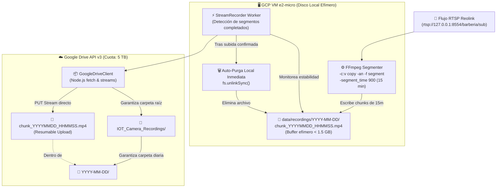

# ADR 22: Grabación Continua de Streaming y Almacenamiento Resiliente en Google Drive

* **Estado**: Aceptado / En Producción  
* **Fecha**: Octubre 2026  
* **Responsable**: Antigravity & Javier  
* **Contexto**: Infraestructura de Streaming, Respaldo Continuo de Video y Protección de Almacenamiento en GCP `e2-micro`

---

## 1. Contexto y Problemática

El sistema **IOT Camera Catcher** opera en una máquina virtual gratuita GCP Compute Engine `e2-micro` (1 GB de RAM, 0.25 vCPU sostenida y disco SSD de 30 GB). Si bien el sistema realiza análisis de visión artificial e inferencia biométrica en tiempo real (YOLOv8 + MobileFaceNet), existía la necesidad imperativa de contar con un registro audiovisual continuo e ininterrumpido de toda la jornada laboral de la barbería para:
1. **Auditoría y Validación Forense**: Respaldar y corroborar con video continuo cada corte de pelo, atención y rotación de clientes detectada por los algoritmos biométricos.
2. **Reentrenamiento y Simulación Offline Fidedigna**: Alimentar el simulador offline y el pipeline en dos pasos con material de video real de días completos sin depender de capturas manuales esporádicas.
3. **Seguridad del Local**: Mantener grabaciones históricas de alta fidelidad accesibles en la nube.

### Limitaciones de Infraestructura y Desafíos Técnicos

1. **Restricción Severa de Almacenamiento Local (Disco de 30 GB)**:  
   Un flujo continuo de video H.264 genera entre 400 MB y 1 GB por hora. En menos de 48 horas de grabación continua, el disco de la VM `e2-micro` se llenaría por completo, provocando la caída del sistema operativo y corrupción de las bases de datos SQLite.
2. **Restricción Crítica de CPU (0.25 vCPU / e2-micro)**:  
   Cualquier intento de recodificar o transcodificar video (H.264 a H.265, reescalado de resolución o compresión por software) saturaría el 100% de la CPU compartida de la máquina virtual, asfixiando por completo el bucle de visión por computadora.
3. **Disponibilidad de 5 TB en Google Drive Personal**:  
   Se cuenta con una cuenta de Google Drive personal con cuota de **5 TB** (~5.49e12 bytes), ideal para retener semanas o meses de grabaciones continuas sin costo adicional de almacenamiento en buckets GCS.
4. **Prohibición de Dependencias Pesadas en Node.js (Agent.md)**:  
   Instalar el paquete oficial `googleapis` añade más de 120 MB de dependencias y decenas de megabytes de sobrecarga en memoria RAM (RSS), violando el límite estricto de memoria de la VM.

---

## 2. Decisión Arquitectónica

Se implementa una solución de grabación continua y subida desacoplada en segundo plano basada en **tres componentes modulares nativos**:



### 1. Rolling Chunks de 15 Minutos con Cero Recodificación (`-c copy`)
El módulo [`StreamRecorder`](file:///Users/javierli/Documents/elmuki/IOTCameraCatcher/src/infrastructure/recording/stream_recorder.js) invoca a FFmpeg como subproceso hijo:
```bash
ffmpeg -y -rtsp_transport tcp -i rtsp://127.0.0.1:8554/barberia/sub \
  -c:v copy -an \
  -f segment -segment_time 900 -segment_format mp4 \
  -reset_timestamps 1 -strftime 1 \
  "data/recordings/%Y-%m-%d/chunk_%Y%m%d_%H%M%S.mp4"
```
* **Cero Impacto de CPU (< 1.5%)**: Al utilizar `-c:v copy -an`, FFmpeg opera como un simple multiplexador de paquetes de red hacia el contenedor MP4 sin decodificar ni recodificar un solo píxel.
* **Pre-creación de carpetas de fecha**: El grabador garantiza de forma preventiva que las carpetas del día actual y siguiente (`YYYY-MM-DD`) existan en disco para prevenir fallos de inicialización en FFmpeg.
* **Segmentación determinista**: Segmentos regulares de 900 segundos (15 minutos) que facilitan la navegación, búsqueda por fecha/hora y reanudación rápida.

### 2. Cliente Google Drive API v3 Nativo (`GoogleDriveClient`)
Implementado en [`src/infrastructure/storage/gdrive_client.js`](file:///Users/javierli/Documents/elmuki/IOTCameraCatcher/src/infrastructure/storage/gdrive_client.js) utilizando exclusivamente primitivas nativas de Node.js (`fetch`, `ReadableStream`, `fs.createReadStream`):
* **Autenticación OAuth2 con Caché en Memoria**: Intercambia el `GDRIVE_REFRESH_TOKEN` por `access_token` en `https://oauth2.googleapis.com/token`. Cachea el token en RAM y solo solicita uno nuevo cuando faltan menos de 5 minutos para su expiración (margen de seguridad).
* **Supervisión de Cuota en Tiempo Real**: Consulta `GET /drive/v3/about?fields=storageQuota,user` para monitorear el consumo de los 5 TB y el espacio restante.
* **Jerarquía Automatizada de Carpetas**:
  - `ensureRootFolder(rootName)`: Localiza o crea la carpeta principal (`IOT_Camera_Recordings`).
  - `ensureDayFolder(dayStr, rootFolderId)`: Localiza o crea la subcarpeta con la fecha del día (`YYYY-MM-DD`) con caché en memoria (`Map`) para evitar consultas repetitivas a la API.

### 3. Protocolo Resumable Upload y Auto-Purga Local Inmediata
Para archivos de video de ~50-150 MB por segmento, se utiliza el protocolo oficial **Resumable Upload de Google Drive v3**:
1. **Paso 1 (Handshake)**: POST a `https://www.googleapis.com/upload/drive/v3/files?uploadType=resumable` con headers `X-Upload-Content-Type: video/mp4` y `X-Upload-Content-Length`. Google retorna un header `Location` con la URI de subida.
2. **Paso 2 (Streaming PUT)**: Se canaliza directamente el stream de lectura de disco (`fs.createReadStream(filePath)`) mediante `fetch` nativo con `duplex: 'half'` sin cargar el archivo completo en memoria RAM.
3. **Paso 3 (Purga Local Inmediata)**: Al recibir confirmación HTTP 200/201 con el ID del archivo creado en Google Drive, el worker ejecuta inmediatamente `fs.unlinkSync(filePath)`. Si el directorio del día queda vacío, se remueve.
4. **Tolerancia a Caídas de Red**: Si la subida falla por desconexión o corte de internet, el archivo permanece intacto en disco local para ser reintentado en el siguiente ciclo del worker.

### 4. Ciclo de Vida y Coordinación con Horario Laboral
En [`src/index.js`](file:///Users/javierli/Documents/elmuki/IOTCameraCatcher/src/index.js):
* El grabador se activa automáticamente dentro del horario laboral configurado en [`WorkingHoursManager`](file:///Users/javierli/Documents/elmuki/IOTCameraCatcher/src/core/working_hours.js) y entra en pausa fuera de horario.
* Parada limpia (`stop()`): Ante señales `SIGINT` o `SIGTERM`, se envía `SIGINT` a FFmpeg para que finalice de forma ordenada y escriba el átomo `moov` al final del MP4, procesando y subiendo los segmentos remanentes antes de cerrar el daemon.
* Se exponen endpoints de diagnóstico:
  - `GET /api/recording/status`: Estado de la grabación, archivo activo, cantidad de segmentos subidos, pendientes y fallidos.
  - `GET /api/recording/quota`: Estado de la cuota de almacenamiento en Google Drive en tiempo real.

---

## 3. Consecuencias y Beneficios

* **Protección Absoluta del Almacenamiento de la VM**: El almacenamiento local actúa únicamente como búfer de tránsito efímero (máximo 1 o 2 archivos simultáneos, < 250 MB), imposibilitando el desbordamiento del disco SSD de 30 GB.
* **Cero Costo Adicional ($0)**: Se aprovechan los 5 TB de almacenamiento ya existentes en Google Drive personal sin incurrir en costos de Google Cloud Storage.
* **Cero Impacto en RAM y Rendimiento**: Implementación 100% nativa sin la biblioteca `googleapis` (>120 MB), manteniendo el consumo del daemon por debajo de 210 MB RSS.
* **Preservación de Archivos de Simulación**: El escaneo y purga están estrictamente restringidos a subdirectorios con formato de fecha `YYYY-MM-DD`, protegiendo de forma blindada los videos benchmark de simulación offline (`data/recordings/barberia_stream_*.mp4`).
* **Operación Manual y Automatizada**: Disponibilidad del comando `npm run record:gdrive` para ejecuciones manuales, diagnósticos y pruebas controladas.
