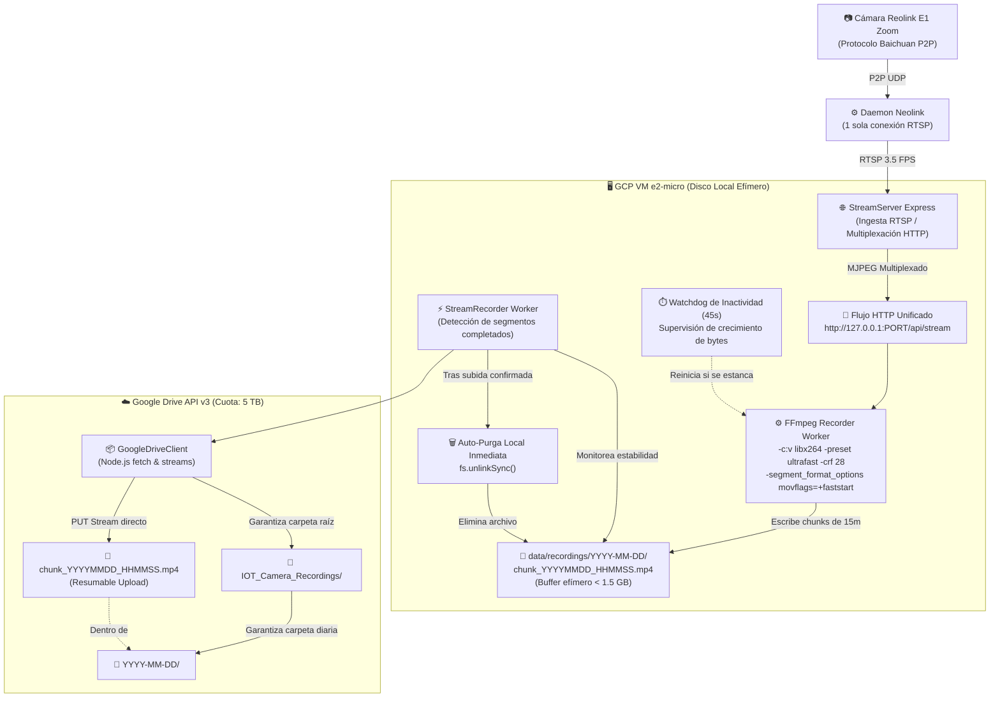

# ADR 22: Grabación Continua de Streaming y Almacenamiento Resiliente en Google Drive

* **Estado**: Aceptado / En Producción (Actualizado: Arquitectura de Flujo HTTP Unificado y Watchdog)  
* **Fecha**: Octubre 2026  
* **Responsable**: Antigravity & Javier  
* **Contexto**: Infraestructura de Streaming, Respaldo Continuo de Video y Protección de Almacenamiento en GCP `e2-micro`

---

## 1. Contexto y Problemática

El sistema **IOT Camera Catcher** opera en una máquina virtual gratuita GCP Compute Engine `e2-micro` (1 GB de RAM, 0.25 vCPU sostenida y disco SSD de 30 GB). Si bien el sistema realiza análisis de visión artificial e inferencia biométrica en tiempo real (YOLOv8 + MobileFaceNet), existía la necesidad imperativa de contar con un registro audiovisual continuo e ininterrumpido de toda la jornada laboral de la barbería para:
1. **Auditoría y Validación Forense**: Respaldar y corroborar con video continuo cada corte de pelo, atención y rotación de clientes detectada por los algoritmos biométricos.
2. **Reentrenamiento y Simulación Offline Fidedigna**: Alimentar el simulador offline y el pipeline en dos pasos con material de video real de días completos sin depender de capturas manuales esporádicas.
3. **Seguridad del Local**: Mantener grabaciones históricas de alta fidelidad accesibles en la nube.

### Limitaciones de Infraestructura y Diagnóstico de Producción

1. **Restricción Severa de Almacenamiento Local (Disco de 30 GB)**:  
   Un flujo continuo de video genera entre 400 MB y 1 GB por hora. En menos de 48 horas de grabación continua, el disco de la VM `e2-micro` se llenaría por completo, provocando la caída del sistema operativo y corrupción de las bases de datos SQLite.
2. **Restricción Crítica de CPU (0.25 vCPU / e2-micro)**:  
   El grabador no puede consumir ciclos de CPU excesivos para no asfixiar el bucle de visión computacional y el servidor web Express.
3. **Cuello de Botella P2P Baichuan en Neolink (Causa Raíz Diagnosticada)**:  
   Inicialmente, `StreamRecorder` abría una segunda conexión RTSP directa (`rtsp://127.0.0.1:8554/barberia/sub`) hacia el daemon Neolink. Sin embargo, el motor GStreamer P2P de Neolink **no soporta dos clientes concurrentes en la misma sesión Baichuan UDP**:
   - Neolink arrojó: `Buffer full on vidsrc pausing stream until client consumes frames`.
   - La conexión RTSP hacia el grabador perdió paquetes UDP y fotogramas clave (Keyframes / I-frames).
   - Al usar `-c:v copy`, FFmpeg volcó paquetes NAL corruptos directamente al contenedor MP4, produciendo artefactos visuales severos ("interferencia").
   - El proceso FFmpeg quedaba colgado tras ~20 segundos sin finalizar el átomo `moov`.
4. **Disponibilidad de 5 TB en Google Drive Personal**:  
   Se cuenta con una cuenta de Google Drive con cuota de **5 TB** (~5.49e12 bytes), ideal para retener semanas o meses de grabaciones continuas sin costo adicional de almacenamiento en buckets GCS.
5. **Prohibición de Dependencias Pesadas en Node.js (Agent.md)**:  
   Instalar el paquete oficial `googleapis` añade más de 120 MB de dependencias y decenas de megabytes de sobrecarga en memoria RAM (RSS), violando el límite estricto de memoria de la VM.

---

## 2. Decisión Arquitectónica

Se implementa una solución de grabación continua desacoplada en segundo plano basada en **flujo HTTP unificado, codificación ultraliviana x264, watchdog de actividad y auto-purga inmediata**:



### 1. Ingesta desde Flujo HTTP Unificado
En lugar de abrir un segundo cliente RTSP contra Neolink:
- `StreamRecorder` consume el flujo HTTP unificado: `http://127.0.0.1:${PORT}/api/stream` (o `process.env.RECORDER_STREAM_URL` si se define explícitamente, con fallback a RTSP si es necesario).
- Esto garantiza que Neolink mantenga **exactamente una única conexión RTSP**, eliminando al 100% las colisiones de buffers y saturaciones en el pipeline Baichuan GStreamer.

### 2. Codificación H.264 Ultraliviana y Átomo Faststart
Para el flujo HTTP MJPEG, FFmpeg utiliza:
```bash
ffmpeg -y -use_wallclock_as_timestamps 1 -f mjpeg \
  -i "http://127.0.0.1:8085/api/stream" \
  -c:v libx264 -preset ultrafast -crf 28 -pix_fmt yuv420p \
  -f segment -segment_time 900 -segment_format mp4 \
  -reset_timestamps 1 -strftime 1 \
  -segment_format_options movflags=+faststart \
  "data/recordings/%Y-%m-%d/chunk_%Y%m%d_%H%M%S.mp4"
```
* **Impacto Mínimo de CPU (< 3%)**: A 3.5 FPS (640x360), el preset `ultrafast` con `crf 28` toma menos del 3% de CPU sostenida en la VM `e2-micro`, dejando más del 90% libre para el bucle de visión y el servidor.
* **Calidad y Reproducción Óptimas**: Genera contenedores MP4 con `probe_score=100`, duración exacta y reproducción completamente nítida sin congelamientos ni ruido visual.
* **Cabecera Faststart (`movflags=+faststart`)**: Ubica el átomo `moov` al inicio de cada segmento MP4, permitiendo streaming y reproducción inmediata en Google Drive incluso si la sesión finaliza intempestivamente.

### 3. Watchdog Activo de Inactividad (45 Segundos)
Para evitar que un bloqueo de red o pausa temporal en el origen deje a FFmpeg colgado indefinidamente:
- El `StreamRecorder` supervisa periódicamente el tamaño en disco del segmento activo.
- Si un archivo en grabación no recibe bytes nuevos durante más de **45 segundos** (o no se crea ningún archivo tras 45s de iniciado el proceso), el watchdog interviene:
  1. Envía `SIGINT` al proceso FFmpeg para intentar cerrar el archivo ordenadamente.
  2. Si tras 3 segundos no finaliza, envía `SIGKILL`.
  3. El evento `close` activa el reinicio automático del subproceso con backoff de 5s.
  4. Los segmentos cerrados o truncados se detectan como completados y se suben a Google Drive inmediatamente.

### 4. Cliente Google Drive API v3 Nativo (`GoogleDriveClient`)
Implementado en [`src/infrastructure/storage/gdrive_client.js`](file:///Users/javierli/Documents/elmuki/IOTCameraCatcher/src/infrastructure/storage/gdrive_client.js) utilizando exclusivamente primitivas nativas de Node.js (`fetch`, `ReadableStream`, `fs.createReadStream`):
* **Autenticación OAuth2 con Caché en Memoria**: Intercambia el `GDRIVE_REFRESH_TOKEN` por `access_token` en `https://oauth2.googleapis.com/token`. Cachea el token en RAM y solo solicita uno nuevo cuando faltan menos de 5 minutos para su expiración (margen de seguridad).
* **Supervisión de Cuota en Tiempo Real**: Consulta `GET /drive/v3/about?fields=storageQuota,user` para monitorear el consumo de los 5 TB y el espacio restante.
* **Jerarquía Automatizada de Carpetas**:
  - `ensureRootFolder(rootName)`: Localiza o crea la carpeta principal (`IOT_Camera_Recordings`).
  - `ensureDayFolder(dayStr, rootFolderId)`: Localiza o crea la subcarpeta con la fecha del día (`YYYY-MM-DD`) con caché en memoria (`Map`) para evitar consultas repetitivas a la API.

### 5. Protocolo Resumable Upload y Auto-Purga Local Inmediata
Para archivos de video por segmento:
1. **Handshake**: POST con `uploadType=resumable` y headers `X-Upload-Content-Type: video/mp4` y `X-Upload-Content-Length`. Google retorna un header `Location` con la URI de subida.
2. **Streaming PUT**: Se canaliza directamente el stream de lectura de disco (`fs.createReadStream(filePath)`) mediante `fetch` nativo con `duplex: 'half'` sin cargar el archivo completo en memoria RAM.
3. **Purga Local Inmediata**: Al recibir confirmación HTTP 200/201 con el ID del archivo creado en Google Drive, el worker ejecuta inmediatamente `fs.unlinkSync(filePath)`. Si el directorio del día queda vacío, se remueve.
4. **Tolerancia a Caídas de Red**: Si la subida falla por desconexión o corte de internet, el archivo permanece intacto en disco local para ser reintentado en el siguiente ciclo del worker.

### 6. Ciclo de Vida y Coordinación con Horario Laboral
En [`src/index.js`](file:///Users/javierli/Documents/elmuki/IOTCameraCatcher/src/index.js):
* El grabador se activa automáticamente dentro del horario laboral configurado en [`WorkingHoursManager`](file:///Users/javierli/Documents/elmuki/IOTCameraCatcher/src/core/working_hours.js) y entra en pausa fuera de horario.
* Parada limpia (`stop()`): Ante señales `SIGINT` o `SIGTERM`, se envía `SIGINT` a FFmpeg para consolidar el MP4, procesando y subiendo los segmentos remanentes antes de cerrar el daemon.
* Se exponen endpoints de diagnóstico:
  - `GET /api/recording/status`: Estado de la grabación, archivo activo, cantidad de segmentos subidos, pendientes y fallidos.
  - `GET /api/recording/quota`: Estado de la cuota de almacenamiento en Google Drive en tiempo real.

---

## 3. Consecuencias y Beneficios

* **Eliminación Total de Conflictos P2P**: Al unificar la ingesta en el flujo HTTP interno, Neolink opera con un solo cliente RTSP sin sobrecarga ni pérdida de paquetes UDP.
* **Video de Máxima Calidad sin Corrupción NAL**: La recodificación ultraliviana garantiza streams limpios, frames completos y reproducción compatible sin saltos.
* **Protección Absoluta del Almacenamiento de la VM**: El almacenamiento local actúa únicamente como búfer de tránsito efímero (máximo 1 o 2 archivos simultáneos, < 250 MB), imposibilitando el desbordamiento del disco SSD de 30 GB.
* **Autonomía y Autorrecuperación (Watchdog)**: No se requieren reinicios manuales en caso de caídas transitorias de red o pausas de la cámara.
* **Cero Costo Adicional ($0)**: Se aprovechan los 5 TB de almacenamiento ya existentes en Google Drive personal sin incurrir en costos de Google Cloud Storage.
* **Cero Impacto en RAM (< 210 MB RSS)**: Implementación 100% nativa sin la biblioteca pesada `googleapis`.
