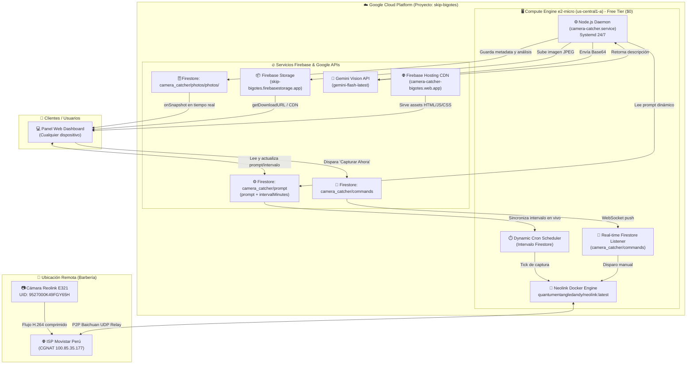
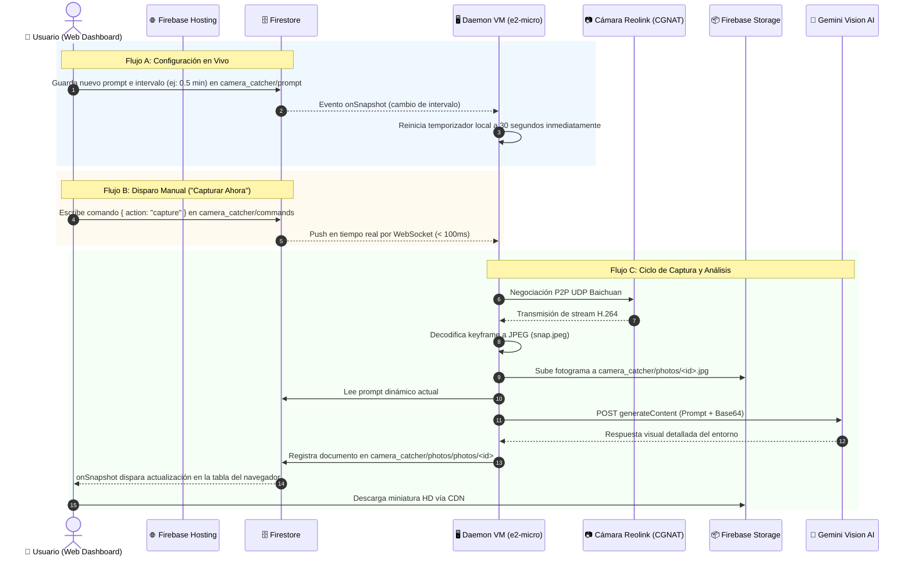

# Registro de Decisiones de Arquitectura (ADRs) - IOT Camera Catcher

Este directorio documenta de manera viva, estricta y transparente todas las decisiones técnicas, herramientas, servicios y componentes que conforman el sistema **IOT Camera Catcher**.

---

## Regla de Oro y Mantenimiento del Stack

> [!IMPORTANT]
> **POLÍTICA DE ACTUALIZACIÓN PERMANENTE**:
> 1. Toda tecnología actualmente en uso en el sistema **DEBE** tener su archivo de decisión técnica en este directorio (`agent/decisions/`).
> 2. Si alguna tecnología es reemplazada, descartada o descontinuada, **su archivo debe ser eliminado de las decisiones activas** y su análisis debe incorporarse de inmediato en [removed.md](file:///Users/javierli/Documents/elmuki/IOTCameraCatcher/agent/decisions/removed.md), explicando detalladamente por qué se descartó, qué problemas presentó y cuál fue la solución adoptada.
> 3. Ningún componente nuevo debe incorporarse al código sin su respectiva documentación en este índice.

---

## Diagrama de Arquitectura Global

---

## Diagrama de Flujo de Datos

---

## Índice de Tecnologías Activas

| Módulo | Tecnología / Herramienta | Rol en la Arquitectura | Archivo de Decisión |
| :--- | :--- | :--- | :---: |
| **P2P Protocol** | Neolink (Rust) | Conexión UDP P2P con protocolo Baichuan y extracción H.264 | [01-reolink-p2p-neolink.md](file:///Users/javierli/Documents/elmuki/IOTCameraCatcher/agent/decisions/01-reolink-p2p-neolink.md) |
| **Cómputo 24/7** | GCP Compute Engine `e2-micro` | VM Linux gratuita (Free Tier $0) con stack de red UDP nativo | [02-gcp-compute-engine-e2-micro.md](file:///Users/javierli/Documents/elmuki/IOTCameraCatcher/agent/decisions/02-gcp-compute-engine-e2-micro.md) |
| **Base de Datos & Bus** | Cloud Firestore | Base NoSQL, bus de comandos en tiempo real y configuración dinámica | [03-firebase-firestore.md](file:///Users/javierli/Documents/elmuki/IOTCameraCatcher/agent/decisions/03-firebase-firestore.md) |
| **Media Storage** | Firebase Storage (GCS) | Almacenamiento seguro de imágenes y distribución CDN de miniaturas | [04-firebase-storage.md](file:///Users/javierli/Documents/elmuki/IOTCameraCatcher/agent/decisions/04-firebase-storage.md) |
| **Inteligencia Visual** | Google Gemini Vision API | Análisis contextual y descripción visual de fotogramas de la barbería | [05-gemini-vision-ai.md](file:///Users/javierli/Documents/elmuki/IOTCameraCatcher/agent/decisions/05-gemini-vision-ai.md) |
| **Detección Local & Cuadrantes** | ONNX Runtime Node + YOLOv8 | Detección de objetos, clientes, sillas y personas en cuadrantes locales ($0) | [08-local-ml-onnx-quadrants.md](file:///Users/javierli/Documents/elmuki/IOTCameraCatcher/agent/decisions/08-local-ml-onnx-quadrants.md) |
| **Frontend Web** | Firebase Hosting + Vanilla JS | Dashboard reactivo en tiempo real sin backend server-rendered | [06-firebase-hosting-web-dashboard.md](file:///Users/javierli/Documents/elmuki/IOTCameraCatcher/agent/decisions/06-firebase-hosting-web-dashboard.md) |
| **CI/CD Automatizado** | GitHub Actions | Despliegue continuo selectivo por carpetas hacia GCP VM y Hosting | [07-github-actions-cicd.md](file:///Users/javierli/Documents/elmuki/IOTCameraCatcher/agent/decisions/07-github-actions-cicd.md) |
| **Monitoreo de Costos & Cuotas** | Calculador Reactivo Vanilla JS | Supervisión preventiva de cuotas GCP Free Tier y simulador de intervalos | [09-google-cloud-cost-monitoring.md](file:///Users/javierli/Documents/elmuki/IOTCameraCatcher/agent/decisions/09-google-cloud-cost-monitoring.md) |

---

## Tecnologías Descartadas y Registro de Eliminaciones

Para conocer las tecnologías que fueron evaluadas, probadas y posteriormente descartadas (como Cloud Functions serverless, decodificadores en JavaScript puro, sockets UDP en navegadores y puertos HTTP públicos), consulta el archivo histórico:
👉 **[removed.md](file:///Users/javierli/Documents/elmuki/IOTCameraCatcher/agent/decisions/removed.md)**
