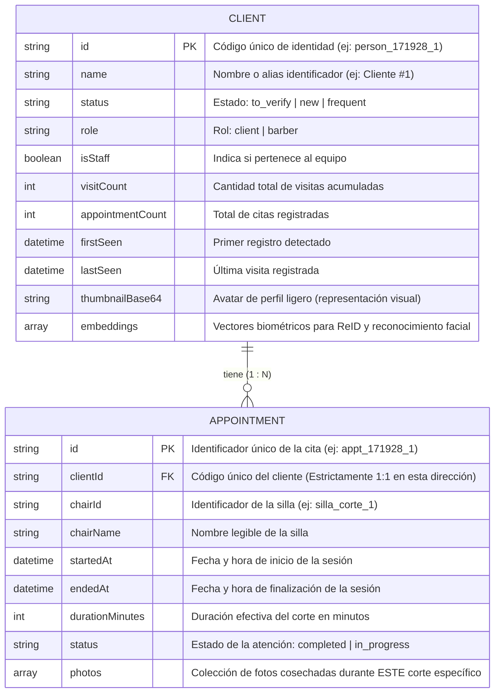

# Modelo de Datos y Relación: Cliente y Atenciones (Appointments)

Este documento detalla la arquitectura de datos canónica para la relación entre **Clientes** (`camera_catcher_people` / tabla `customers`) y **Atenciones** (`camera_catcher_appointments` / tabla `appointments`).

---

## 1. Diagrama de Relación de Entidades (Mermaid)

---

## 2. Principios de Arquitectura

### 2.1 Regla de Cardinalidad Estricta (1 : N)
- **1 Cliente tiene N Atenciones (Appointments):** A lo largo del tiempo, cada vez que un cliente acude a la barbería y se sienta en una silla de corte, se genera una nueva atención.
- **1 Atención pertenece a EXACTAMENTE 1 Cliente:** Una cita nunca tiene múltiples clientes. La relación inversa es estrictamente 1:1 (`appointment.clientId`).

### 2.2 Almacenamiento Canónico de Fotografías
- **Las fotografías de corte se almacenan en el `appointment`:** Cada sesión de corte genera sus propias tomas, ángulos y variaciones de luz. Pertenecen exclusivamente al evento temporal de ese corte (`appointment.photos`).
- **El Cliente NO almacena fotos redundantes:** La entidad `Client` solo mantiene:
  - Su código único (`id`).
  - Su nombre/alias.
  - Su avatar de perfil representativo (`thumbnailBase64`).
  - Sus vectores biométricos (`embeddings`) requeridos para la identificación facial algorítmica cuando el cliente vuelva a ingresar.

### 2.3 Flujo de Retorno (Identificación Biométrica ReID)
Cuando una persona se sienta en una silla y es identificada como un cliente existente:
1. El sistema recupera el `clientId` existente.
2. Incrementa el contador de visitas (`visitCount = visitCount + 1`) y actualiza `lastSeen`.
3. Crea un **nuevo registro de atención** con un nuevo ID (`appt_${timestamp}_${trackId}`), asignando `clientId = client.id`.
4. Las fotos cosechadas durante esa nueva sesión se persisten dentro de ese nuevo registro de atención.
5. Al consultar el cliente en el frontend, su historial mostrará todas sus citas cronológicas, cada una con su propia galería de fotos.

---

## 3. Integridad y Ciclo de Vida

- **Sin Duplicación de Datos:** El nombre, tipo de cliente y avatar se leen reactivamente desde el `Client` usando `appointment.clientId`.
- **Eliminación y Limpieza:** Si un cliente es eliminado del sistema, todas sus atenciones asociadas se eliminan en cascada para evitar registros huérfanos.
