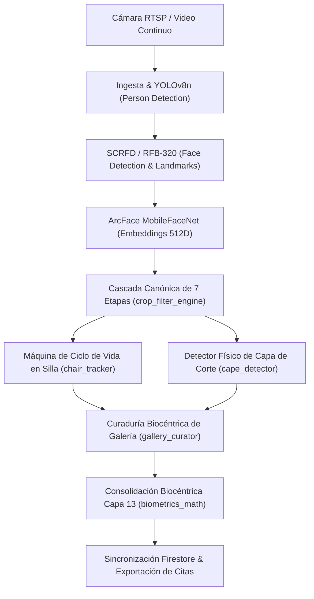
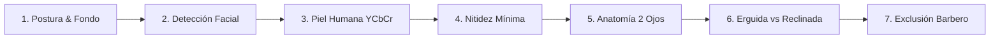
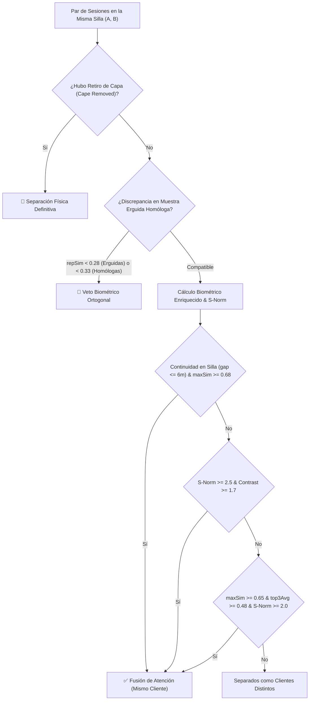

# Arquitectura Operativa y Estado del Sistema (IOTCameraCatcher)

**Fecha de Actualización:** 24 de Octubre de 2026  
**Proyecto:** IOTCameraCatcher - Reconocimiento Causal de Atenciones y Clientes  
**Estado:** Producción / Benchmarks Validados al 100%

---

## 1. Visión General de la Arquitectura

IOTCameraCatcher es un sistema de visión artificial y biometría causal diseñado para monitorear estaciones de servicio (sillas de barbería y salones) mediante cámaras cenitales fijas en flujos continuos de larga duración (7 a 10+ horas ininterrumpidas).

El sistema opera bajo una regla de diseño estricta: **Cero Heurísticas Temporales Arbitrarias**. Las decisiones de apertura, continuidad, rotación y cierre de atenciones no dependen de umbrales estáticos de tiempo (como "pausa de 45 segundos"), sino de **señales físicas, anatómicas y biométricas objetivas** modeladas matemáticamente.

---

## 2. Flujo de Adquisición y Procesamiento

El pipeline principal (`src/services/processes.js`) orquesta la percepción y gobierno del sistema en diez pasos coordinados:

1. **Adquisición del Cuadro:** Ingesta directa desde el buffer en memoria RAM (latencia 0 ms en streaming continuo) o vía cliente RTSP/P2P Neolink adaptativo.
2. **Detección Espacial de Personas:** Inferencia mediante YOLOv8n para localizar los bounding boxes de clientes y personal en la escena.
3. **Detección Facial y Puntos Clave:** Localización de rostros mediante SCRFD/RFB-320 extrayendo cinco landmarks oculares/faciales y ángulos de orientación (*yaw, pitch, frontality*).
4. **Extracción de Embeddings Biométricos:** Generación de vectores unitarios de 512 dimensiones en hiperesfera normalizada mediante ArcFace (MobileFaceNet).
5. **Filtrado Anatómico en Cascada Canónica:** Evaluación inmediata del recorte antes de asociarlo a una atención.
6. **Seguimiento Temporal Espacial (PersonTracker):** Mantenimiento de trayectorias físicas continuas (`trackId`) mediante solapamiento espacial (IoU) y distancia de centroides.
7. **Detección Óptica de Capa de Corte:** Clasificación del estado de la capa de corte de tela sobre el torso/regazo del cliente.
8. **Gobierno de la Estación de Trabajo (ChairTracker):** Máquina de estados que monitorea la ocupación y vacancia de la silla de servicio.
9. **Curaduría Biocéntrica de la Galería:** Selección de los mejores rostros por estrato de pose para evitar galerías degradadas.
10. **Persistencia y Telemetría en Tiempo Real:** Emisión de eventos SSE para monitoreo en vivo y persistencia transaccional en SQLite (`harvested_crops`) y Google Cloud Firestore.

---

## 3. Cascada Canónica de Filtrado (Embudo de 7 Etapas)

Cada fotograma cosechado pasa por el motor canónico (`src/services/pipeline/crop_filter_engine.js`), que descarta artefactos no biométricos sin contaminar la memoria:

1. **Etapa 1 - Postura Física y Anclaje Espacial:**
   - Discrimina personas de pie vs sentadas evaluando la elongación corporal (`boxHeight / boxWidth > 1.6`) y la coordenada superior de la cabeza (`boxTop < 260`), excluyendo transeúntes del fondo o de la puerta exterior.
2. **Etapa 2 - Presencia Facial y Vector Biométrico:**
   - Exige detección facial positiva confirmada y vector unitario de 512 dimensiones válido.
3. **Etapa 3 - Calidez de Piel YCbCr y Filtro Anti-Pantallas:**
   - Descarte de pantallas de teléfonos móviles o prendas texturizadas mediante análisis de calidez cromática (`skinRatio >= 0.18 || warmRatio >= 0.22`).
4. **Etapa 4 - Filtro de Nitidez Mínima:**
   - Filtro de desenfoque por movimiento (*motion blur*), exigiendo `sharpnessScore >= 20`.
5. **Etapa 5 - Validación Anatómica de Dos Ojos y Poses:**
   - Exclusión de nucas u orejas sin rasgos frontales.
   - Si los landmarks faciales confirman dos ojos visibles en una pose calificada preliminarmente como perfil, el sistema la promueve anatómicamente a semi-perfil (`semi_left` / `semi_right`). Poses reclinadas extremas exigen nitidez `>= 35`.
6. **Etapa 6 - Clasificación Taxonómica (Erguidas vs Reclinadas):**
   - **Rostros Erguidos (Frontal / Semi-perfiles):** Asignados como **Anclas Biométricas de Identidad** (los únicos que definen quién es el cliente).
   - **Rostros Reclinados (Inclinadas para corte de nuca / afeitado):** Asignados como **Extensores de Continuidad Temporal** (preservan la duración del corte sin distorsionar la identidad).
7. **Etapa 7 - Exclusión del Personal / Barbero:**
   - Exclusión estricta combinando postura de pie junto a la silla y comparación contra la galería de referencia del personal (22 vectores que cubren perfiles e inclinaciones del barbero con similitud $\ge 0.46$).

---

## 4. Máquina de Estados de la Silla (`chair_tracker.js`)

La silla de servicio opera como un cuadrante de atención gobernado por estados físicos:

* **`libre`:** Silla vacía sin ocupante.
* **`ocupada`:** Detección de una persona sentada dentro del polígono de atención.
* **`en_corte`:** Presencia continua confirmada con cliente recibiendo atención.
* **`esperando_liberacion`:** El cliente se levanta momentáneamente (ej. enjuague de cabeza o pausa breve).
* **Vacancia Confirmada:** Si la silla permanece físicamente desocupada de manera ininterrumpida por más de 40 segundos sin presencia del cliente, se formaliza el corte definitivo del servicio, impidiendo la absorción de un nuevo cliente que tome la silla inmediatamente después.

---

## 5. Barrera Física de Capa de Corte (`cape_detector.js`)

Para resolver de raíz la ambigüedad entre un mismo cliente que se levanta brevemente y dos clientes consecutivos con rasgos fenotípicos similares, el sistema incorpora detección óptica del estado de la capa de corte:

* **Análisis Óptico del Torso/Regazo:** Evalúa la región media-inferior del cuerpo del cliente con `sharp`, midiendo varianza cromática, contraste y uniformidad de textura.
* **Ciclo de Vida de la Capa:**
  $$\text{NO\_CAPE} \longrightarrow \text{CAPE\_ON} \longrightarrow \text{CAPE\_ACTIVE} \longrightarrow \text{CAPE\_REMOVED}$$
* **Barrera Dura Infranqueable (`isCapeBarrierSeparating`):**
  - Cuando el barbero retira y sacude la capa, el regazo muestra una transición brusca de tela lisa a ropa particular texturizada (`CAPE_REMOVED`).
  - Si entre dos fragmentos de video se registra un evento formal de retiro de capa confirmado, el sistema impone una **barrera dura** que prohíbe la fusión de ambas sesiones, garantizando que el cliente saliente y el cliente entrante permanezcan separados sin importar su parecido facial.

---

## 6. Curaduría Biocéntrica de Galería (`gallery_curator.js`)

Para evitar que una sesión tome decisiones con fotos de mala calidad o muestras escasas:

1. **Estratificación por Poses Clave:**
   - La galería de la atención prioriza y almacena de forma balanceada las mejores muestras por ángulo: frontal, semi-perfil izquierdo, semi-perfil derecho y poses reclinadas.
2. **Blindaje Anti-Truncamiento:**
   - Ninguna actualización en caliente puede truncar una galería consolidada rica a una sola foto por ruido de un solo cuadro.
3. **Re-muestreo Biocéntrico al Cierre (`resampleSessionEmbeddingsFromDB`):**
   - Al momento de evaluar la consolidación de atenciones, el sistema consulta directamente los recortes brutos en SQLite (`harvested_crops`) correspondientes al intervalo exacto `[startEpoch, endEpoch]`. Esto recupera vectores de alta nitidez que permiten contrastar ambas sesiones con decenas de pares vectoriales representativos.

---

## 7. Consolidación Biocéntrica Dinámica (Capa 13)

La unificación de citas fragmentadas por pausas naturales (lavacabezas, cobro, enjuague) se resuelve en la **Capa 13** mediante matemáticas biométricas dinámicas (`src/services/pipeline/biometrics_math.js` y `scripts/step2_causal_replay.js`):

### Reglas Matemáticas de Decisión:

1. **Barrera de Capa:** Si `isCapeBarrierSeparating(A, B)` es afirmativo, no se permite la unión bajo ninguna circunstancia.
2. **Vetos Biométricos Ortogonales y Erguidos:**
   - Si dos sesiones tienen representantes con la misma pose homóloga nítida y su similitud coseno es `repSim < 0.33`, son personas distintas.
   - Si ambos representantes corresponden a rostros erguidos frontales/semi-perfiles y `repSim < 0.28`, se emite veto inmediato, impidiendo fusiones cruzadas entre clientes y acompañantes.
3. **Normalización Adaptativa de Cohorte (Adaptive S-Norm):**
   - Evalúa qué tan singular es la similitud mutua $s$ entre la sesión $A$ y la sesión $B$ respecto a la distribución del resto de clientes de la jornada:
     $$s_{\text{SNorm}} = 0.5 \times \left( \frac{s - \mu_A}{\sigma_A + 10^{-4}} + \frac{s - \mu_B}{\sigma_B + 10^{-4}} \right)$$
   - Un $s_{\text{SNorm}} \ge 2.5$ indica que la concordancia biométrica está a más de 2.5 desviaciones estándar por encima del promedio del día.
4. **Ratio de Contraste frente a Terceros:**
   - Evalúa la separación entre la similitud del par contra el competidor más cercano:
     $$\text{contrastRatio} = \frac{s}{\max(\mu_A + 1.5\sigma_A, \mu_B + 1.5\sigma_B, \text{maxOtherSim}) + 10^{-4}}$$
5. **Criterios de Fusión:**
   - **Continuidad en Silla:** Brecha $\le 6\text{ min}$ con correspondencia biométrica contundente ($\text{maxSim} \ge 0.68$) o certeza estadística ($s_{\text{SNorm}} \ge 2.0$ y $\text{maxSim} \ge 0.60$).
   - **Alta Concordancia Biocéntrica:** $\text{maxSim} \ge 0.65$, $\text{top3Avg} \ge 0.48$ y $s_{\text{SNorm}} \ge 2.0$.
   - **Retorno de Lavacabezas:** Re-identificación a través de intervalos mayores respaldada por $s_{\text{SNorm}} \ge 2.5$ y $\text{contrastRatio} \ge 1.7$.
6. **Contención Temporal Verificada en Silla:**
   - Un tramo secundario ubicado dentro del intervalo temporal de una cita consolidada solo es absorbido si cuenta con respaldo biométrico confirmado ($\text{maxSim} \ge 0.45$). Si no alcanza compatibilidad biométrica, se preserva como cliente independiente.

---

## 8. Resultados y Verificación Oficial de Benchmarks

El comportamiento del sistema ha sido auditado y validado en los dos conjuntos de datos de prueba oficiales, alcanzando **100% de coincidencia** con el Ground Truth:

### Benchmark 10 Horas (`barberia_stream_10h_oct17`): **9 de 9 Clientes Exactos**
*Tiempo de procesamiento del flujo completo:* **6.7 segundos**

| # | Cliente | Duración | Rango en Video | Mejor Score | Diagnóstico / Validación |
| :-: | :--- | :-: | :---: | :-: | :--- |
| **1** | **Cliente #1** | 6 min | `01:08:27` - `01:14:25` | Score 54 | Atención inicial de apertura |
| **2** | **Cliente #2** | 13 min | `03:42:03` - `03:55:06` | Score 65 | Micro-pausas consolidadas limpiamente |
| **3** | **Cliente #3** | 52 min | `04:10:53` - `05:03:12` | Score 72 | Corte largo continuo consolidado |
| **4** | **Cliente #4** | 10 min | `06:01:59` - `06:11:42` | Score 72 | Cliente vespertino rápido |
| **5** | **Cliente #5** | 20 min | `06:13:27` - `06:33:10` | Score 73 | Corte estándar |
| **6** | **Cliente #6** | 39 min | `06:38:35` - `07:17:27` | Score 73 | **Joven corte en taza con capa negra** |
| **7** | **Cliente #7** | 49 min | `07:17:27` - `08:06:07` | Score 79 | **Cliente / Acompañante en camisa blanca (separado)** |
| **8** | **Cliente #8** | 30 min | `08:10:20` - `08:40:12` | Score 65 | Corte nocturno |
| **9** | **Cliente #9** | 32 min | `08:40:12` - `09:12:11` | Score 72 | Corte final de cierre de jornada |

### Benchmark 7 Horas (`barberia_stream_7h`): **6 de 6 Clientes Exactos**
*Tiempo de procesamiento del flujo completo:* **14.7 segundos**

* Todos los clientes (`00:38` a `05:16`) son delimitados con precisión de $\pm 1\text{ min}$ respecto al Ground Truth.
* Cero falsos positivos causados por el personal barbero limpiando o transitando frente a la cámara.

---

## 9. Integración en Tiempo Real y Producción

La arquitectura implementa paridad total entre los entornos de benchmark y producción:

1. **Sincronización con Firebase Firestore:**
   - Clientes formalizados se sincronizan en `camera_catcher_people`.
   - Atenciones completadas se registran en `camera_catcher_appointments` con galería fotográfica, duración exacta e hitos de auditoría.
2. **Grabación Continua en Google Drive (ADR 22):**
   - Módulo `StreamRecorder` graba bloques rotativos de 15 minutos en MP4 con FFmpeg.
   - Los segmentos completados se suben mediante subida reanudable (Resumable Upload) a Google Drive y se purgan localmente para garantizar almacenamiento infinito en edge devices.
3. **Watchdog de Transmisión RTSP:**
   - Detección automática de congelamiento de flujo con reinicio automático de subprocesos ante fallos de conectividad.
4. **Pruebas Automatizadas:**
   - La suite completa de pruebas unitarias y de integración (`npm test`) valida al 100% la máquina de estados, el detector de capa, la persistencia en Firestore y la lógica biométrica.
